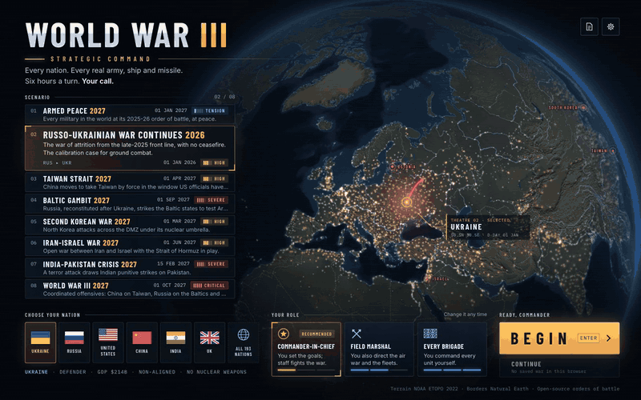
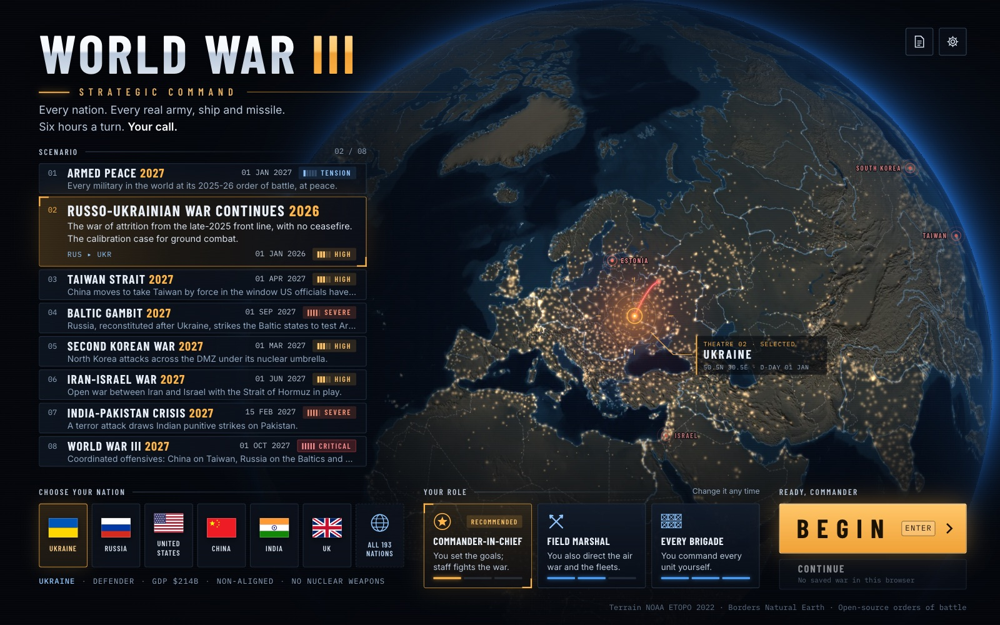
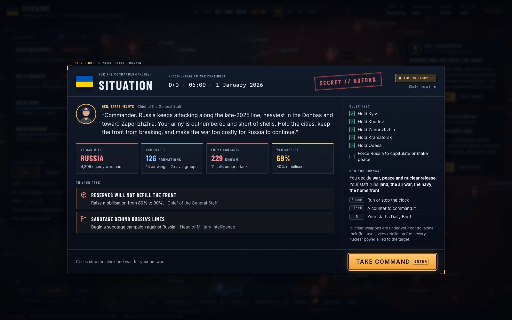
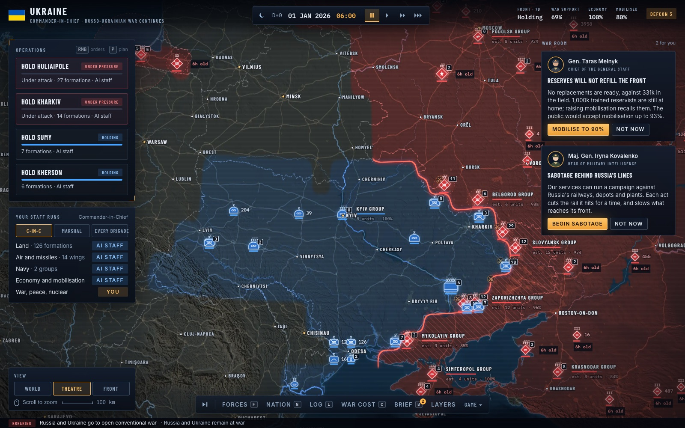
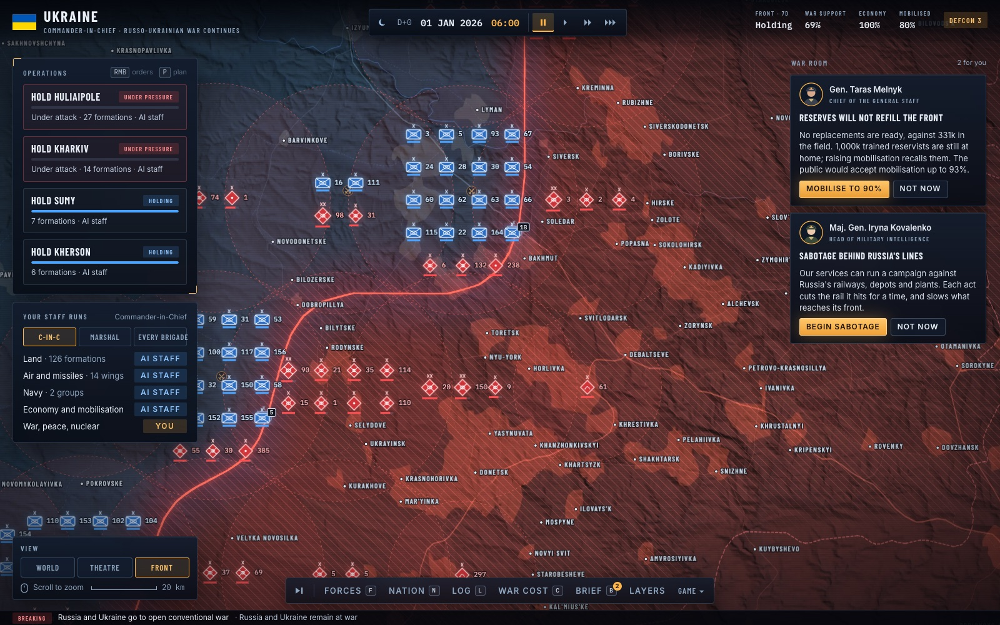
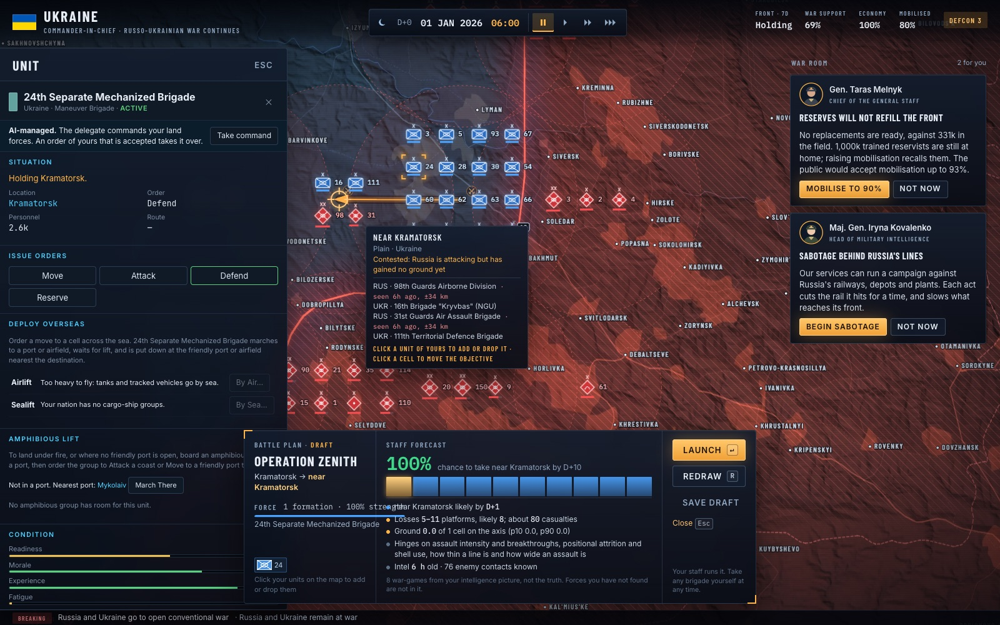
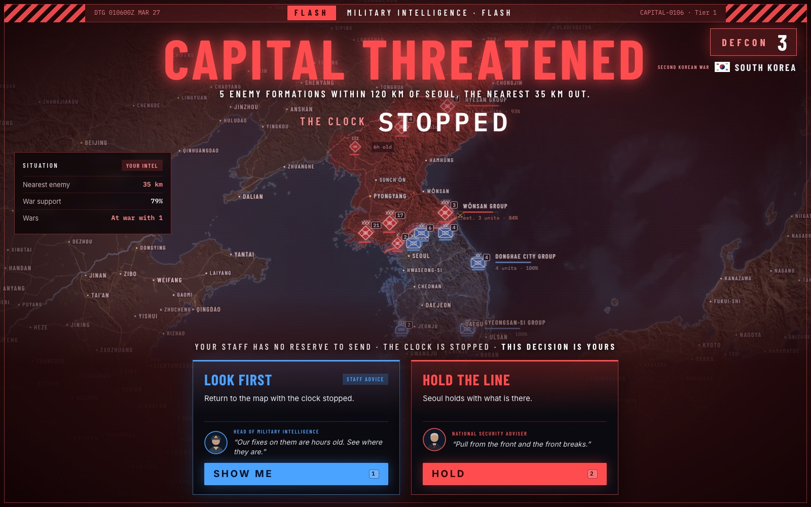
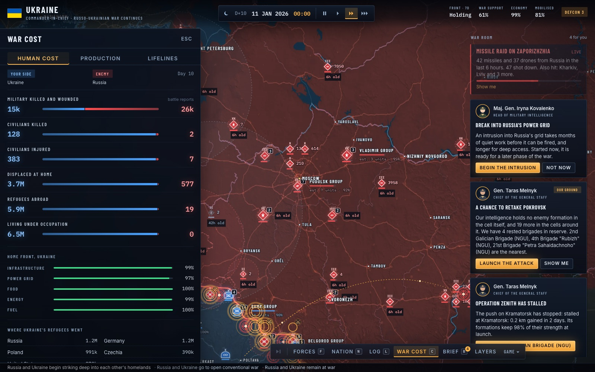

# WW3 Simulator

A deterministic, data-driven simulation of a modern great-power war. It models every
country, the real order of battle of every military, more than a thousand weapon
systems, and the logistics, industry, diplomacy and nuclear escalation that decide
how a war actually goes.

You can play any of the 193 nations in the browser, save and resume a war from the Game
menu, or run scenarios headless and measure the outcome.

[](docs/media/demo.mp4)

The clip above is the first days of `ukraine-2026` played as Ukraine. The [full video](docs/media/demo.mp4)
runs 48 seconds.

## Screenshots

| | |
| --- | --- |
|  |  |
| Pick a scenario, a nation and how much you command yourself. | The general staff's situation report opens the war. |
|  |  |
| The theatre as your intelligence sees it: your forces in blue, the enemy where it was last fixed. | Zoom to the front and every counter is a real brigade. |
|  |  |
| Plan an operation and the staff war-games it from your intelligence picture. | A crisis stops the clock until you decide, with each adviser's recommendation. |
|  | |
| War Cost counts the dead, the displaced and the production race. | |

## Quick start

```sh
npm install
npm run dev                                         # browser UI at http://localhost:5173
npm run sim -- --list                               # list scenarios
npm run sim -- --scenario taiwan-2027 --days 30     # run headless and print events
npm run sim -- --scenario taiwan-2027 --days 10 --save run.json  # save the run at the end
npm run sim -- --resume run.json --days 20          # carry on from a save, tick for tick
npx tsx scripts/realism.ts ukraine-2026 30 1 RUS,UKR  # measured outcomes as JSON
```

Checks:

```sh
npm test          # unit and integration suite
npm run perf      # per-system time budgets, run serially
npm run realism   # scenario outcomes against historical reference bands
npm run validate  # held-out historical cases scored against a naive baseline
npm run ensemble -- --scenario ukraine-2026 --days 30 --runs 16  # spread over seeds and tagged params
npm run typecheck
```

## Scenarios

| id | What happens |
| --- | --- |
| `peace-2027` | Every military at its 2025-26 strength, at peace. Declare any war you like. |
| `ukraine-2026` | The Russo-Ukrainian war continues from the late-2025 front line. This is the ground-combat calibration case. |
| `taiwan-2027` | China tries to take Taiwan by force. US, Japanese and Australian entry is decided by their own governments. |
| `baltic-2027` | Russia attacks Estonia, Latvia and Lithuania to test Article 5. |
| `korea-2027` | North Korea attacks across the DMZ. |
| `gulf-2027` | Open war between Iran and Israel. |
| `south-asia-2027` | India and Pakistan go to war. |
| `ww3-2027` | All of the above at once. |

## What is simulated

- **Geography.** 18,250 land cells and about 4,400 sea zones, built from Natural Earth.
  Most cells are one degree. The hot fronts (Ukraine, the Baltic and Kaliningrad, the
  Suwalki gap, Korea and the DMZ, the Caucasus, Israel and southern Lebanon) use half- and
  quarter-degree cells. Terrain, elevation and ruggedness come from the ETOPO 2022 relief
  model, and each cell's population from GHS-POP 2020. Straits split the cells on either
  shore, and bridges and tunnels such as the Channel Tunnel are explicit fixed links.
  Strategic islands such as Guam, Okinawa and Hawaii have their own cells.
- **Weather and seasons.** Each day the weather of every 5-degree region is drawn around
  its climate normal. Snow lies and melts, the ground freezes and thaws, and mud follows
  the autumn rains and the spring thaw. Weather slows movement, grounds sorties, holds landing
  craft in heavy seas, and costs troops in the open to cold.
- **Nations.** World Bank economic data for all 193 states. Each state also has a
  government type, treaty memberships (30 treaties with their real obligations),
  opinions of other states, FAS 2025 nuclear forces, and a doctrine-based strategic
  profile.
- **Forces.** About 3,150 formations at real bases: brigades, air wings, carrier
  groups, submarine squadrons, missile brigades and nuclear triads. US, NATO, Ukraine,
  Russia, China, North Korea, Iran and 32 other states are modelled by hand from IISS
  Military Balance 2025 and official sources. The other 124 states get forces
  generated from their manpower, budget and arms supplier.
- **Catalog.** More than 1,000 platforms and 430 munitions, from the T-55 to the B-21
  and from the 155 mm shell to the Avangard. Each has cost, speed, range, fuel burn,
  armor, stealth, sensors, firepower by target class, kill probabilities, CEP and yield.
- **Land war.** Lanchester attrition driven by catalog firepower and modified by Dupuy
  terrain factors, entrenchment, supply, air control, artillery reach and combined
  arms. Units retreat, rout, get encircled and surrender.
- **Air and missile war.** Sortie generation, stealth-dependent BVR combat, AWACS and
  tankers. Integrated air defense uses salvo interception math, and interceptor stocks
  run out. Strikes, SEAD and one-way drone swarms are modelled.
- **Naval war.** Hughes salvo combat, layered fleet missile defence, submarine and
  anti-submarine warfare, mines and mine clearing, ten named chokepoints, blockades that cut
  each nation's seaborne trade, and amphibious landings. Sealift and RO-RO ships carry
  heavy units abroad and unload at the nearest port clear of enemy shore missiles.
- **Logistics.** Supply networks shared within each bloc run from depots over rail,
  road, sea and air. Supply decays with distance from the railhead, and pockets get
  nothing. Fronts are fed along the line of contact, and host nations supply foreign
  bases. Repair, replacement from national stockpiles, new brigades raised from surplus
  reserves, and infrastructure damage and repair are modelled.
- **Economy and industry.** Wartime mobilization with realistic ramp-up lags.
  Production lines for shells, missiles, aircraft and ships run at sourced peacetime
  and surge rates. Imports of energy, chips, rare earths and explosives, sanctions,
  blockade shocks, deficits and the training pipeline are modelled. A production order
  beyond what the defence budget buys is paid from the treasury, and a new line takes
  years to reach the plant a nation can build.
- **Strategic war.** Nuclear release, missile defense, and blast and thermal effects
  scaled from Glasstone and Dolan against real city populations. Fallout drifts on
  prevailing winds and decays. ASAT and orbital debris, cyber attacks, and nuclear
  winter's effect on food are included.
- **Command, control and intelligence.** Each belligerent has a chain of command from its
  national command authority down to army and corps HQs. Struck or overrun HQs and jammed
  radio, satellite and GNSS links slow orders and weaken fire. Each nation sees only what
  its sensors fix: bases, contact, airborne ISR, reconnaissance satellites and tracked
  warships. Between fixes its picture goes stale.
- **Civilians and home front.** Residents flee fighting, occupation, strikes and a
  threatened capital at rates calibrated on Ukraine in 2022. Casualties, cost of living and
  lost output move public opinion, which caps how far a government can mobilize and how
  long a democracy keeps fighting. Autocracies answer to regime stability instead.
- **Diplomacy and AI.** Treaty cascades with per-member reliability and delays.
  Escalation ladders per pair of nations, war support, capitulation (which needs both the
  will and the means to fight to be gone) and peace. AI commanders hold fronts, attack only
  at local 3:1, task air, missile and naval forces, deploy coalition forces overseas
  through staging hosts, and use nuclear weapons only when their doctrine's threshold is
  crossed. Any domain of a human player's nation can be delegated to the AI.

## What the numbers are worth

Read [Validation status](docs/validation.md) before quoting any output. In short, the ground
model is tuned on Ukraine 2022-25, so a passing realism band means "tuned", not "validated".
Four modern cases the model was not fitted to (Nagorno-Karabakh 2020, Kursk 2024, Operation
Sindoor 2025 and the Twelve-Day War 2025) are scored against a "nothing changes" baseline, and
the model beats it on 5 of their 19 untuned questions today. Multi-theatre and world-war outcomes, nuclear
escalation, diplomacy beyond who joins a war, and anything past 90 days have never been
validated. [Calibration knobs and ensembles](docs/calibration.md) explains the tagged params and
why one seed is an anecdote.

## How it is built

See [ARCHITECTURE.md](ARCHITECTURE.md). In short, the whole state of a run is one plain
JSON `World`. Systems run in a fixed order each 6-hour tick, and all randomness comes
from a seeded RNG, so a seed replays a war exactly. Data and models cite their sources
inline. Each realism band in `tests/*.realism.test.ts` names the historical reference
it is checked against.

The decision trail for how this was built is in [.audit/decisions.tsv](.audit/decisions.tsv).

## Data sources

Natural Earth (public domain); World Bank WDI (CC BY 4.0); ETOPO 2022 relief, NOAA NCEI
(public domain); GHS-POP R2023A, European Commission JRC (CC BY 4.0); IISS Military Balance 2025;
SIPRI; FAS Status of World Nuclear Forces 2025; US DoD China Military Power Report; CSIS
Missile Threat and wargame reports; RAND; CRS; Oryx; ISW. Figures recalled from these
sources are rounded estimates and are labelled as such in the code.
